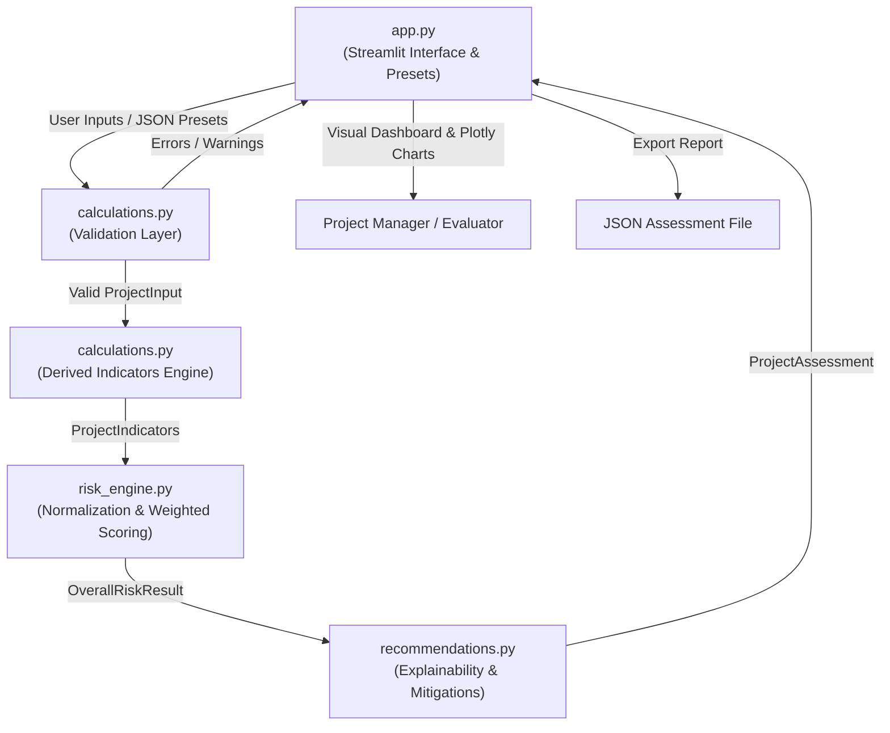

# System Architecture: Project Risk Predictor

## 1. Overview and Purpose

The **Project Risk Predictor** is a web-based, explainable, rule-based decision support system designed for Software Engineering and Project Management (SEPM). It evaluates software project health across four primary risk dimensions (**Schedule**, **Resources**, **Quality**, **Requirements**) and an optional fifth dimension (**Budget**).

Rather than treating risk as an inscrutable black box, the system decomposes overall risk into observable project indicators, normalizes components transparently, applies documented weighted aggregations, and produces actionable mitigation recommendations linked directly to numerical findings.

---

## 2. Architectural Design

The system follows a clean modular separation of concerns:

---

## 3. Module Breakdown and Responsibilities

### `calculations.py`
- **Data Models**: Strongly-typed dataclasses (`ScheduleMetrics`, `ResourceMetrics`, `QualityMetrics`, `RequirementMetrics`, `BudgetMetrics`, `ProjectInput`).
- **Validation**: Strict boundary and semantic checking (e.g., tasks completed cannot exceed total tasks, critical bugs cannot exceed open bugs, non-negative constraints, division-by-zero protection).
- **Derived Metrics**:
  - Task progress vs. time elapsed.
  - Schedule variance ($SV = \text{Progress} - \text{Elapsed}$).
  - Overdue detection and days overdue.
  - Team availability percentage and availability shortfall.
  - Workload spread and peak overload.
  - Defect severity ratio and bug growth trend (including zero-baseline handling).
  - Scope change rate and volatility frequency.

### `risk_engine.py`
- **Component Normalization**: Maps raw indicators to a standard 0–100 risk scale.
- **Category Scoring**: Weighted linear combination of components per category.
- **Weight Redistribution**: Dynamically redistributes the optional 5% budget weight across the core four categories when budget evaluation is disabled.
- **Classification**: Categorizes scores into `LOW` (0–39.9), `MEDIUM` (40–69.9), and `HIGH` (70–100).
- **Determinism**: Fully deterministic, pure mathematical functions with no side effects.

### `recommendations.py`
- **Evidence Extraction**: Formulates human-readable contributing factors based on actual metrics (e.g., specific variance percentages, delayed task counts, staffing deficits).
- **Mitigation Synthesis**: Suggests targeted SEPM actions (e.g., schedule compression, workload rebalancing, defect swarm, change control board enforcement).
- **Decoupling**: Separates raw category scores from the qualitative explanations explaining *why* the score occurred.

### `app.py`
- **Presentation Layer**: Built with Streamlit and Plotly.
- **Interactive Forms**: Grouped inputs with validation feedback.
- **Preset Scenarios**: One-click loaders for healthy, delayed, quality crisis, and understaffed projects.
- **Visual Analytics**: Real-time KPI delta metrics, category risk bar chart, and radar profile.
- **Export**: One-click download of structured JSON risk assessments.

---

## 4. Extensibility & Future Milestones

The architecture intentionally isolates data modeling, calculation, scoring, and UI presentation:
- **Milestone 2 (Database & History)**: An SQLite repository layer can be introduced between `calculations.py` and `app.py` without altering the risk scoring engine.
- **Milestone 3 (Risk Register & Alerts)**: Risk register entities (`RiskItem(id, likelihood, impact, owner)`) can consume `CategoryRiskResult` directly.
- **Milestone 4 (Machine Learning Baseline)**: ML models can sit alongside `risk_engine.py` as an alternative scorer while retaining the rule-based engine as an interpretable baseline.
